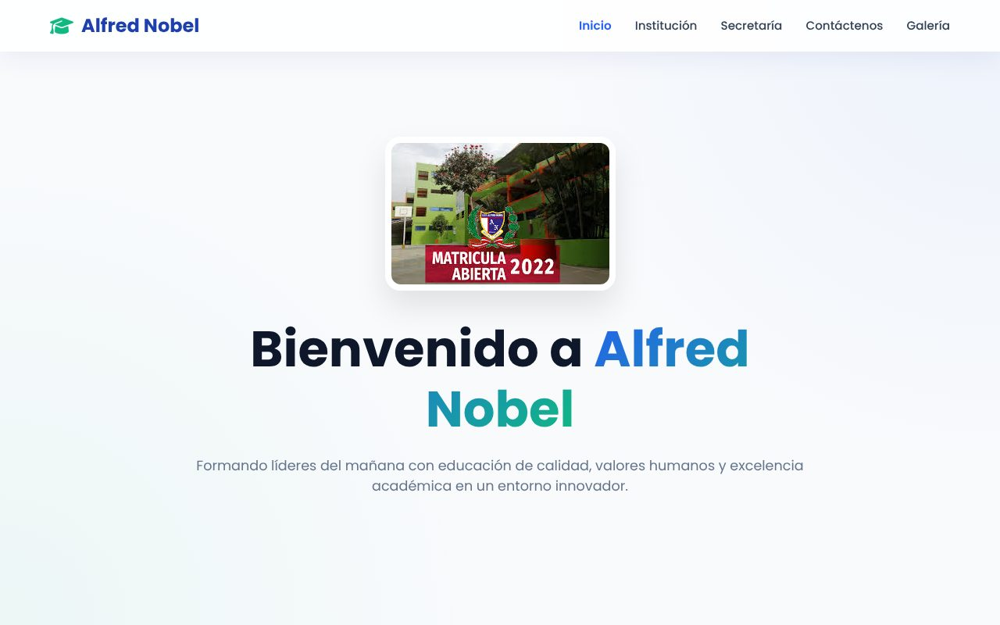
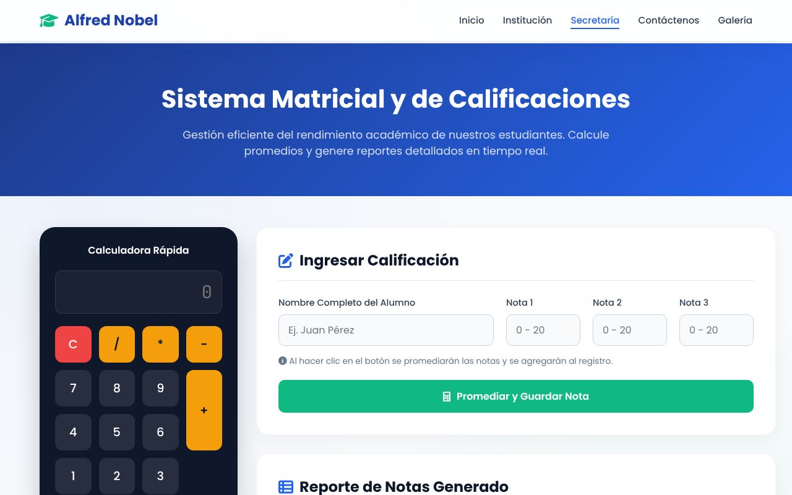
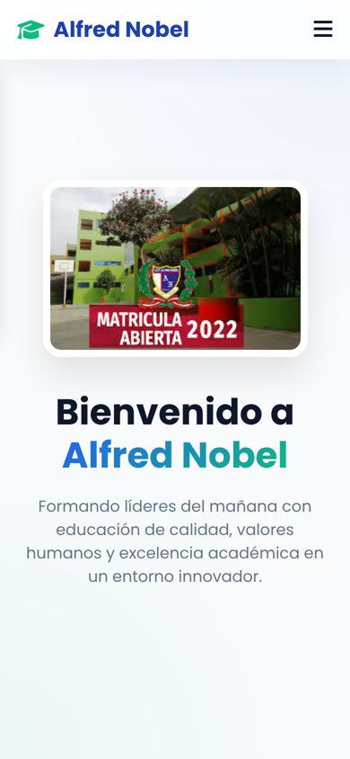

# I.E. Alfred Nobel · Plataforma Web

Sitio web institucional del colegio **Alfred Nobel** (Lima, Perú), hecho solo con HTML, CSS y JavaScript, sin frameworks ni dependencias de compilación. Incluye un módulo de secretaría que calcula promedios y genera el reporte de notas en el navegador.

**Demo en vivo:** https://briansaa.github.io/Instituci-n-Educativa---Plataforma-Web/



## Funcionalidades

| Página | Qué hace |
|---|---|
| `index.html` | Portada con los niveles Inicial, Primaria y Secundaria |
| `institucion.html` | Misión, visión e historia con barra lateral fija y mapa de Google Maps |
| `notas.html` | Calculadora y registro de notas: valida rangos (0–20), promedia y marca aprobado/desaprobado |
| `contactenos.html` | Formulario de contacto con validación y alertas |
| `galeria.html` | Galería en mosaico con CSS Grid y visor de imágenes (lightbox) sin librerías |



## Tecnologías

- **HTML5 semántico**
- **CSS3**: variables, Grid, Flexbox, `backdrop-filter` (glassmorphism) y diseño adaptable a móvil
- **JavaScript (vanilla)**: lógica de notas, galería, validaciones y menú móvil
- **SweetAlert**, **Font Awesome 6** y **Google Fonts** (Poppins) por CDN

## Cómo correrlo

No necesita instalación. Clona el repo y abre `trabajo_final_grupal/index.html` en el navegador, o levanta un servidor local:

```bash
git clone https://github.com/briansaa/Instituci-n-Educativa---Plataforma-Web.git
cd Instituci-n-Educativa---Plataforma-Web/trabajo_final_grupal
python3 -m http.server 8000   # luego abre http://localhost:8000
```

## Estructura

```
trabajo_final_grupal/
├── index.html · institucion.html · notas.html · contactenos.html · galeria.html
├── js/promediar2.js        # lógica del registro de notas
├── img/                    # fotos de la galería
└── assets/img/             # logo, banners y niveles
```

## Despliegue

El workflow `.github/workflows/pages.yml` publica la carpeta `trabajo_final_grupal` en GitHub Pages cada vez que hay un push a `main`.

## Versión móvil



---

Trabajo final grupal (Grupo D.D.S.). Rediseño 2.0 y mantenimiento: **[Brian Saavedra](https://github.com/briansaa)**.
